# HTML to PDF in C# on Windows, Linux, macOS and Docker

This is a complete, hands-on guide to converting HTML to PDF in C# with [SelectPdf.Universal](https://selectpdf.com/pdf-library-cross-platform/), the cross-platform edition of the SelectPdf library for .NET. The same project builds and runs on Windows (x64 and x86), Linux (x64 and ARM64), macOS on Apple Silicon and in Docker. Every one of the 29 code steps is a full, compiling example taken straight from this project, so the code you copy is code that actually runs.

Sections 1 to 22 follow the same steps as the [classic Windows tutorial](../html-to-pdf/), ported to the Universal API, so you can compare the two side by side. Sections 23 to 29 cover what only the Universal library does: asynchronous conversion, tables of contents, fillable forms, PDF/UA-2, redaction, signature validation and Word to PDF. The guide ends with running on Linux and in Docker, the remote engine for Alpine and Kubernetes, and production and troubleshooting notes.

## Getting started

Add the package for the platform you deploy to. It installs the library together with that platform's Chromium engine:

```bash
dotnet add package SelectPdf.Universal.Windows
```

| Platform | Package |
|---|---|
| Windows x64 / x86 | `SelectPdf.Universal.Windows` |
| Linux x64 | `SelectPdf.Universal.Linux` |
| Linux ARM64 | `SelectPdf.Universal.Linux.Arm64` |
| macOS on Apple Silicon | `SelectPdf.Universal.MacOS` |

An app built once for several platforms can reference `SelectPdf.Universal` plus one `SelectPdf.Universal.Native.<rid>` package per runtime (`win-x64`, `win-x86`, `linux-x64`, `linux-arm64`, `osx-arm64`) instead. Use one route or the other, not both. For text in scripts beyond Latin, Greek and Cyrillic (Arabic, Hebrew, CJK, Hindi, Thai, emoji), also add `SelectPdf.Universal.Fonts`.

This project picks the right platform package for the machine you build it on, so on any supported OS just run:

```bash
dotnet run
```

Running the project writes each result PDF to `output/` and the preview images shown below into `images/`. Without a license key every page carries a trial watermark. To remove it, set your key in the `SELECTPDF_LICENSE_KEY` environment variable before running.

### Coming from the classic library?

The port from the [classic tutorial](../html-to-pdf/) took only a handful of changes. The [migration guide](https://selectpdf.com/pdf-library-classic/html/Migrating-To-SelectPdf-Universal.htm) lists them all.

- **Namespace** - `using SelectPdf;` becomes `using SelectPdf.Universal;`.
- **One engine** - Chromium is the only engine, so the `RenderingEngine = RenderingEngine.Chromium` lines are gone.
- **No System.Drawing** - `new Font("Arial", 8)` becomes `PdfFont.CreateFromSystemFont("Liberation Sans", 8)`, and `Color` becomes `PdfColor`. Liberation Sans, Serif and Mono ship with the library and match the metrics of Arial, Times New Roman and Courier New.
- **Renamed** - `MinPageLoadTime` is `ConversionDelay` and `MaxPageLoadTime` is `NavigationTimeout`. The old names still compile, with an obsolete warning.
- **Removed** - `AutoFitWidth` / `AutoFitHeight` are gone. Section 14 uses `FitWideContent` instead.
- **Safer defaults** - a password alone now encrypts with AES-256, and `PdfDocument` is `IDisposable`, so `using` can replace `Close()`.

## Contents

**Part 1 - Getting started**

1. [Convert an HTML string to PDF](#1-convert-an-html-string-to-pdf)
2. [Convert a URL to PDF](#2-convert-a-url-to-pdf)
3. [Convert a local HTML file to PDF](#3-convert-a-local-html-file-to-pdf)

**Part 2 - Build a real document**

4. [Build an invoice from a template](#4-build-an-invoice-from-a-template)
5. [Render complex HTML that paginates](#5-render-complex-html-that-paginates)

**Part 3 - Control the page layout**

6. [Set page size, orientation and margins](#6-set-page-size-orientation-and-margins)
7. [Add headers and footers with page numbers](#7-add-headers-and-footers-with-page-numbers)
8. [Use HTML for headers and footers](#8-use-html-for-headers-and-footers)
9. [Generate bookmarks from HTML headings](#9-generate-bookmarks-from-html-headings)
10. [Produce a single-page PDF](#10-produce-a-singlepage-pdf)
11. [Add a watermark to every page](#11-add-a-watermark-to-every-page)

**Part 4 - Dynamic and remote content**

12. [Wait for JavaScript-rendered content](#12-wait-for-javascriptrendered-content)
13. [Inject custom CSS and run a script](#13-inject-custom-css-and-run-a-script)
14. [Control the viewport width and fit wide content](#14-control-the-viewport-width-and-fit-wide-content)
15. [Send HTTP headers and cookies](#15-send-http-headers-and-cookies)
16. [Convert only part of a page](#16-convert-only-part-of-a-page)

**Part 5 - Secure, archive, integrate**

17. [Set the document properties](#17-set-the-document-properties)
18. [Password-protect and restrict permissions](#18-passwordprotect-and-restrict-permissions)
19. [Create an archivable PDF/A-3 document](#19-create-an-archivable-pdfa3-document)
20. [Create a ZUGFeRD / Factur-X e-invoice](#20-create-a-zugferd--facturx-einvoice)
21. [Add custom XMP metadata](#21-add-custom-xmp-metadata)
22. [Generate a PDF in ASP.NET Core](#22-generate-a-pdf-in-aspnet-core)

**Part 6 - Only in SelectPdf.Universal**

23. [Convert asynchronously](#23-convert-asynchronously)
24. [Generate a table of contents with page numbers](#24-generate-a-table-of-contents-with-page-numbers)
25. [Turn an HTML form into fillable PDF fields](#25-turn-an-html-form-into-fillable-pdf-fields)
26. [Create an accessible PDF/UA-2 document](#26-create-an-accessible-pdfua2-document)
27. [Redact text and patterns](#27-redact-text-and-patterns)
28. [Sign a PDF and validate the signature](#28-sign-a-pdf-and-validate-the-signature)
29. [Convert a Word document to PDF](#29-convert-a-word-document-to-pdf)

**Part 7 - Run it in production**

30. [Run on Linux and in Docker](#30-run-on-linux-and-in-docker)
31. [Use the remote engine for Alpine and Kubernetes](#31-use-the-remote-engine-for-alpine-and-kubernetes)
32. [Running in production](#32-running-in-production)
33. [Troubleshooting](#33-troubleshooting)

**FAQ**

34. [Frequently asked questions](#34-frequently-asked-questions)

## Part 1 - Getting started

### 1. Convert an HTML string to PDF

The simplest conversion: render a raw HTML string into a PDF document in a few lines of code.

```csharp
// Create the HTML to PDF converter. Chromium is the only engine, so there is nothing to select.
HtmlToPdf converter = new HtmlToPdf();

// Convert a raw HTML string into a PDF document.
PdfDocument doc = converter.ConvertHtmlString(
    "<h1>Hello, SelectPdf!</h1>" +
    "<p>This PDF was generated from an HTML string in C#.</p>");

// Save the document to disk, then release the native resources.
doc.Save(outputPdf);
doc.Close();
```

**Output:**

<a href="images/html-to-pdf-universal-section01.png"></a>

> Full source: [Section01_HtmlStringToPdf.cs](Section01_HtmlStringToPdf.cs)

### 2. Convert a URL to PDF

Point the converter at any public web address and capture the rendered page as a PDF.

```csharp
HtmlToPdf converter = new HtmlToPdf();

// Convert a live web page to a PDF document.
PdfDocument doc = converter.ConvertUrl("https://www.selectpdf.com");

doc.Save(outputPdf);
doc.Close();
```

**Output:**

<a href="images/html-to-pdf-universal-section02.png">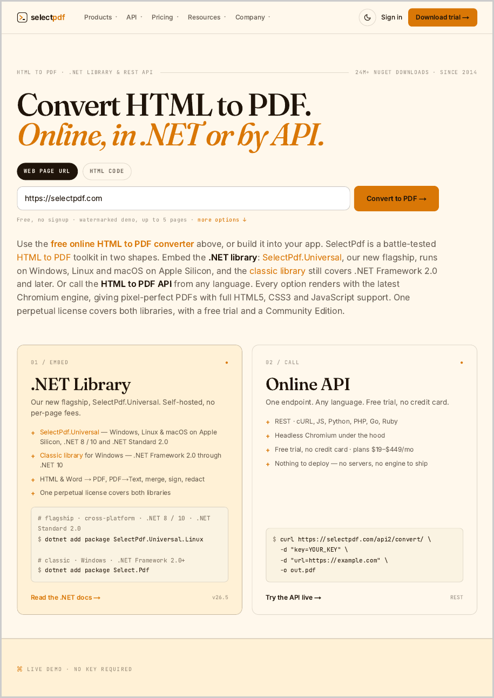</a>

> Full source: [Section02_UrlToPdf.cs](Section02_UrlToPdf.cs)

### 3. Convert a local HTML file to PDF

Render an HTML file from disk - together with its local CSS and images - into a PDF.

```csharp
HtmlToPdf converter = new HtmlToPdf();

// ConvertUrl also accepts a local file path; relative CSS and images
// referenced by the file are resolved automatically.
PdfDocument doc = converter.ConvertUrl(htmlFile);

doc.Save(outputPdf);
doc.Close();
```

**Output:**

<a href="images/html-to-pdf-universal-section03.png">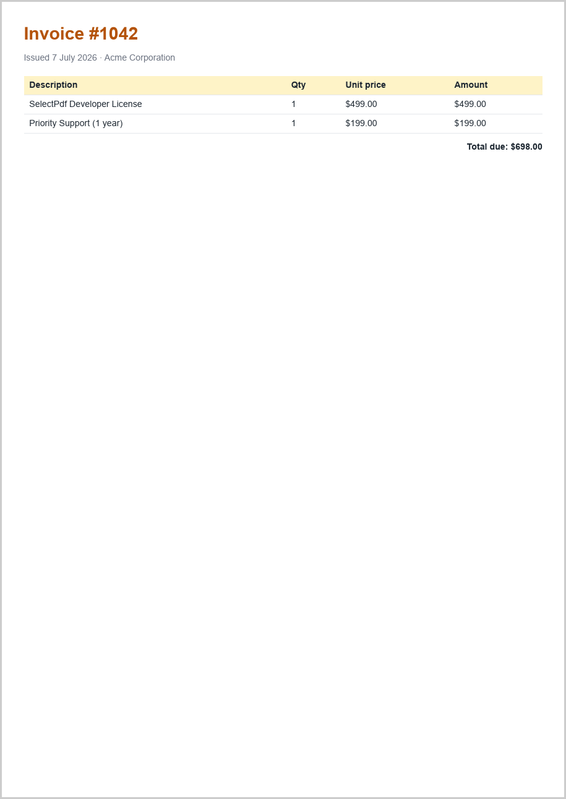</a>

> Full source: [Section03_HtmlFileToPdf.cs](Section03_HtmlFileToPdf.cs)

## Part 2 - Build a real document

### 4. Build an invoice from a template

Turn a C# data model into a styled, real-world invoice: branded header, a line-item table, VAT totals and a page-numbered footer.

```csharp
// 1) Your data - normally from a database or an order.
var items = new[]
{
    new LineItem { Description = "SelectPdf Developer License", Qty = 1, UnitPrice = 499m },
    new LineItem { Description = "Priority Support (1 year)",    Qty = 1, UnitPrice = 199m },
    new LineItem { Description = "On-site training (per day)",    Qty = 2, UnitPrice = 900m },
};

// 2) Render the data into an HTML template (see BuildInvoiceHtml in the source).
string html = BuildInvoiceHtml("INV-1042", items);

// 3) Convert to PDF, adding a footer with page numbers.
HtmlToPdf converter = new HtmlToPdf();
converter.Options.MarginTop = 20;
converter.Options.MarginBottom = 30;

converter.Options.DisplayFooter = true;
converter.Footer.Height = 28;
PdfTextSection pageNo = new PdfTextSection(0, 8,
    "Invoice INV-1042 - page {page_number} of {total_pages}",
    PdfFont.CreateFromSystemFont("Liberation Sans", 8));
pageNo.HorizontalAlign = PdfTextHorizontalAlign.Right;
converter.Footer.Add(pageNo);

PdfDocument doc = converter.ConvertHtmlString(html);
doc.Save(outputPdf);
doc.Close();
```

**Output:**

<a href="images/html-to-pdf-universal-section04.png">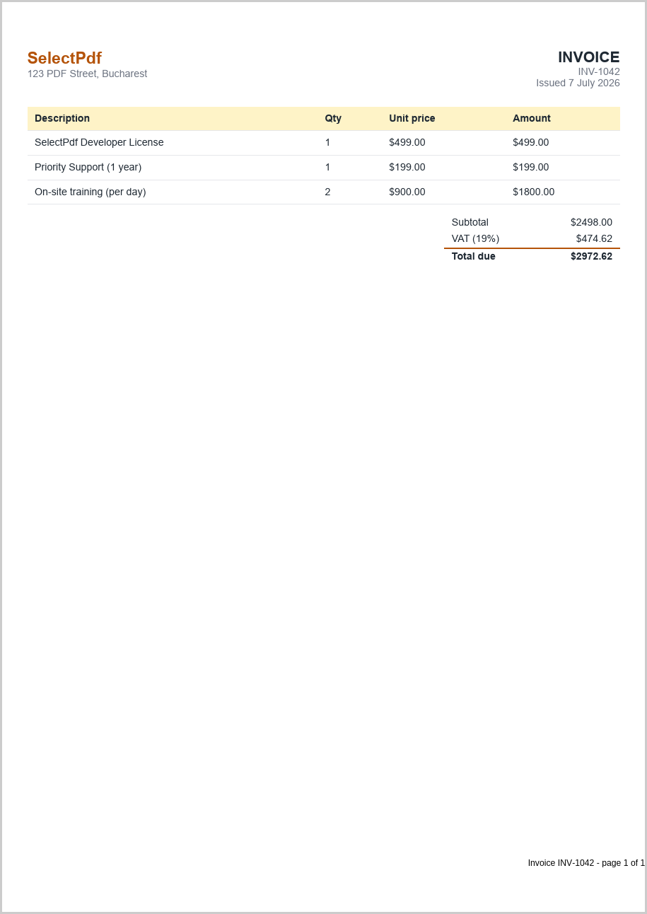</a>

> Full source: [Section04_InvoiceTemplate.cs](Section04_InvoiceTemplate.cs)

### 5. Render complex HTML that paginates

Prove the engine handles modern CSS - grid layout and a live web font - plus a long table whose header repeats on every page.

```csharp
HtmlToPdf converter = new HtmlToPdf();

// Give the web font a moment to download before the page is captured.
converter.Options.ConversionDelay = 2;

// The report uses CSS grid, a Google web font, and a 30-row table.
// The table header repeats on every page (thead { display: table-header-group })
// and rows are kept whole (page-break-inside: avoid) - all controlled from CSS.
PdfDocument doc = converter.ConvertHtmlString(BuildReportHtml());

doc.Save(outputPdf);
doc.Close();
```

**Output:**

<a href="images/html-to-pdf-universal-section05.png">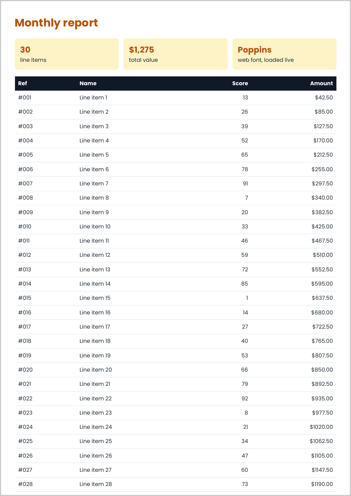</a>

> Full source: [Section05_ComplexHtml.cs](Section05_ComplexHtml.cs)

## Part 3 - Control the page layout

### 6. Set page size, orientation and margins

Control the physical page: choose A4, switch to landscape, and set the page margins.

```csharp
HtmlToPdf converter = new HtmlToPdf();

// Page setup (margins are expressed in points; 72 points = 1 inch).
converter.Options.PdfPageSize = PdfPageSize.A4;
converter.Options.PdfPageOrientation = PdfPageOrientation.Landscape;
converter.Options.MarginLeft = 36;
converter.Options.MarginRight = 36;
converter.Options.MarginTop = 36;
converter.Options.MarginBottom = 36;

PdfDocument doc = converter.ConvertHtmlString(
    "<h1>A4 Landscape</h1>" +
    "<p>This page uses a custom size, orientation and half-inch margins.</p>");

doc.Save(outputPdf);
doc.Close();
```

**Output:**

<a href="images/html-to-pdf-universal-section06.png">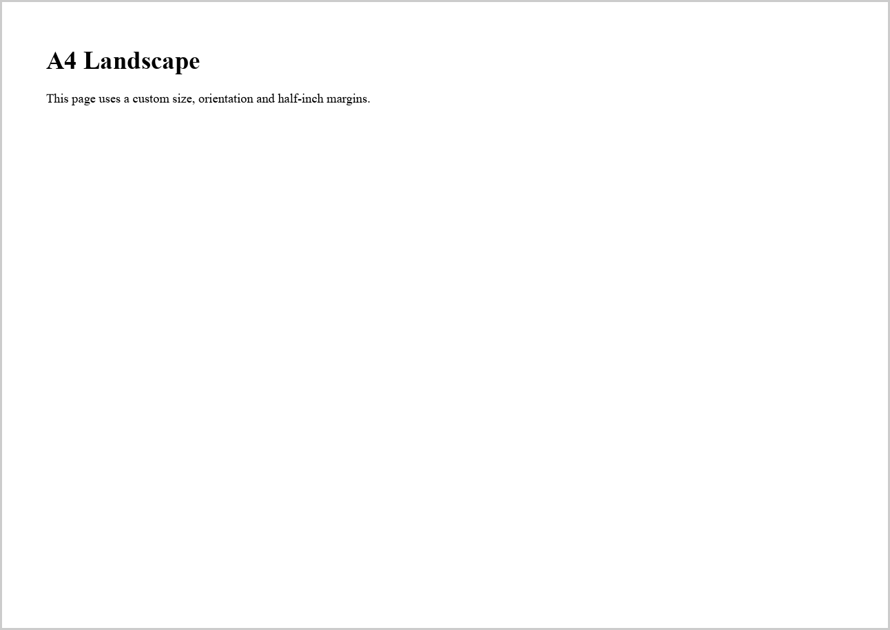</a>

> Full source: [Section06_PageSettings.cs](Section06_PageSettings.cs)

### 7. Add headers and footers with page numbers

Draw a repeating header on every page and a footer that shows "Page X of Y".

```csharp
HtmlToPdf converter = new HtmlToPdf();

// Enable and populate the header.
converter.Options.DisplayHeader = true;
converter.Header.Height = 40;
PdfTextSection headerText = new PdfTextSection(
    0, 12, "SelectPdf Tutorial", PdfFont.CreateFromSystemFont("Liberation Sans", 10, PdfFontStyle.Bold));
headerText.HorizontalAlign = PdfTextHorizontalAlign.Left;
converter.Header.Add(headerText);

// Enable and populate the footer with page numbering tokens.
converter.Options.DisplayFooter = true;
converter.Footer.Height = 40;
PdfTextSection footerText = new PdfTextSection(
    0, 12, "Page {page_number} of {total_pages}", PdfFont.CreateFromSystemFont("Liberation Sans", 8));
footerText.HorizontalAlign = PdfTextHorizontalAlign.Right;
converter.Footer.Add(footerText);

PdfDocument doc = converter.ConvertUrl("https://www.selectpdf.com");

doc.Save(outputPdf);
doc.Close();
```

**Output:**

<a href="images/html-to-pdf-universal-section07.png">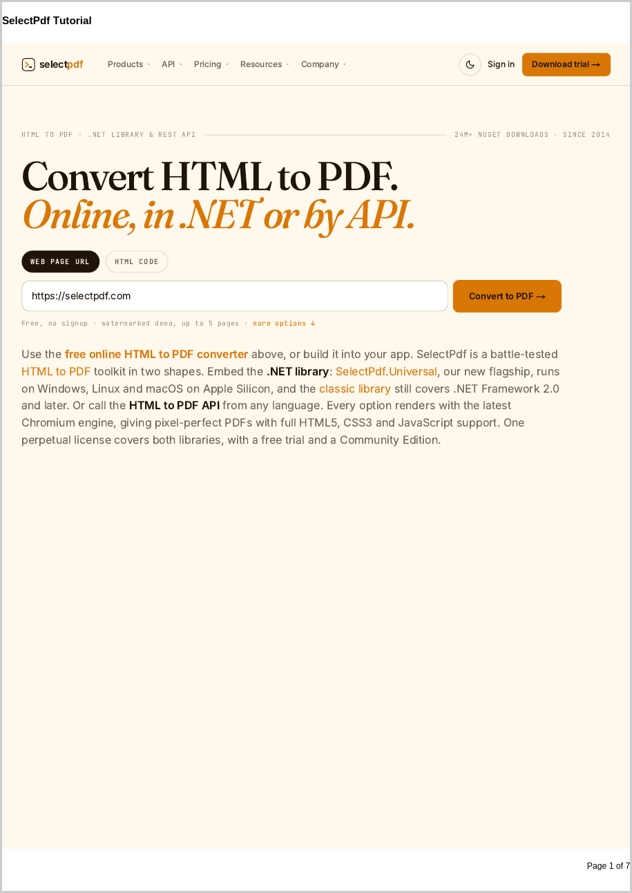</a>

> Full source: [Section07_HeadersAndFooters.cs](Section07_HeadersAndFooters.cs)

### 8. Use HTML for headers and footers

Build a fully styled header or footer from an HTML fragment instead of plain text.

```csharp
HtmlToPdf converter = new HtmlToPdf();

// Render the header from an HTML fragment so it can be fully styled with CSS.
converter.Options.DisplayHeader = true;
converter.Header.Height = 50;

PdfHtmlSection header = new PdfHtmlSection(
    "<div style='font-family:Arial;color:#b45309;font-size:18px;" +
    "border-bottom:2px solid #b45309;padding:6px 0;'>Acme Corporation</div>",
    string.Empty);
converter.Header.Add(header);

PdfDocument doc = converter.ConvertHtmlString(
    "<h1>Report body</h1><p>The header above is rendered from HTML.</p>");

doc.Save(outputPdf);
doc.Close();
```

**Output:**

<a href="images/html-to-pdf-universal-section08.png"></a>

> Full source: [Section08_HtmlHeaderFooter.cs](Section08_HtmlHeaderFooter.cs)

### 9. Generate bookmarks from HTML headings

Turn the document's headings into a clickable PDF bookmarks (outline) tree.

```csharp
HtmlToPdf converter = new HtmlToPdf();

// Build PDF bookmarks from the elements matching these CSS selectors.
converter.Options.PdfBookmarkOptions.CssSelectors = new string[] { "h1", "h2" };

// Open the document with the bookmarks (outline) panel visible.
converter.Options.ViewerPreferences.PageMode = PdfViewerPageMode.UseOutlines;

PdfDocument doc = converter.ConvertHtmlString(
    "<h1>Chapter 1</h1><p>Introduction.</p>" +
    "<h2>Section 1.1</h2><p>Details.</p>" +
    "<h1>Chapter 2</h1><p>More content.</p>");

doc.Save(outputPdf);
doc.Close();
```

**Output:**

<a href="images/html-to-pdf-universal-section09.png">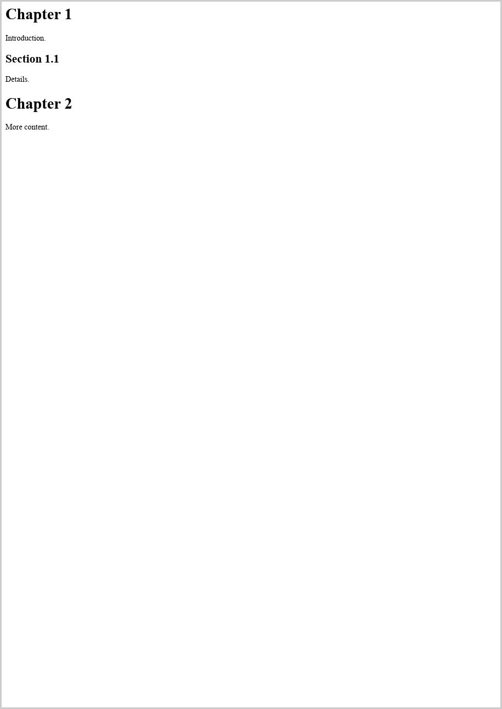</a>

> Full source: [Section09_Bookmarks.cs](Section09_Bookmarks.cs)

### 10. Produce a single-page PDF

Fit the whole document onto one continuous page with no page breaks - handy for receipts and tickets.

```csharp
HtmlToPdf converter = new HtmlToPdf();

// Produce one continuous page sized to the content, instead of paginating.
converter.Options.GenerateSinglePagePdf = true;

PdfDocument doc = converter.ConvertHtmlString(
    "<h1>Single-page output</h1>" +
    "<p>Section one.</p><p>Section two.</p><p>Section three.</p>" +
    "<p>All content stays on a single, taller page with no page breaks.</p>");

doc.Save(outputPdf);
doc.Close();
```

**Output:**

<a href="images/html-to-pdf-universal-section10.png"></a>

> Full source: [Section10_SinglePagePdf.cs](Section10_SinglePagePdf.cs)

### 11. Add a watermark to every page

Stamp a semi-transparent text watermark - such as CONFIDENTIAL or DRAFT - behind the content of every page.

```csharp
HtmlToPdf converter = new HtmlToPdf();

PdfDocument doc = converter.ConvertHtmlString(
    "<h1>Draft report</h1><p>Every page of this document carries a watermark.</p>");

// Draw a large, light "CONFIDENTIAL" behind the content of every page,
// using a background template that repeats on all pages.
PdfFont font = doc.AddFont(PdfStandardFont.Helvetica);
font.Size = 50;

RectangleF pageRect = doc.Pages[0].ClientRectangle;
PdfTemplate template = doc.AddTemplate(pageRect);
template.Background = true;

PdfTextElement watermark = new PdfTextElement(
    0, pageRect.Height / 2 - 30, pageRect.Width, "CONFIDENTIAL", font);
watermark.ForeColor = new PdfColor(210, 210, 210);
watermark.HorizontalAlign = PdfTextHorizontalAlign.Center;
template.Add(watermark);

doc.Save(outputPdf);
doc.Close();
```

**Output:**

<a href="images/html-to-pdf-universal-section11.png"></a>

> Full source: [Section11_Watermark.cs](Section11_Watermark.cs)

## Part 4 - Dynamic and remote content

### 12. Wait for JavaScript-rendered content

Give client-side scripts time to run so dynamic content is captured instead of a half-loaded page.

```csharp
HtmlToPdf converter = new HtmlToPdf();

// Give client-side scripts time to run before the page is captured (seconds).
converter.Options.ConversionDelay = 2;

PdfDocument doc = converter.ConvertHtmlString(
    "<h1>Dynamic content</h1>" +
    "<p id='status'>Loading...</p>" +
    "<script>setTimeout(function(){" +
    "document.getElementById('status').innerHTML = 'Loaded by JavaScript!';" +
    "}, 800);</script>");

doc.Save(outputPdf);
doc.Close();
```

**Output:**

<a href="images/html-to-pdf-universal-section12.png"></a>

> Full source: [Section12_WaitForJavaScript.cs](Section12_WaitForJavaScript.cs)

### 13. Inject custom CSS and run a script

Restyle the page with your own CSS and execute JavaScript after load, without touching the source HTML.

```csharp
HtmlToPdf converter = new HtmlToPdf();

// Inject additional CSS into the page before rendering.
converter.Options.CustomCSS =
    "body { font-family: Arial; background: #fef3c7; }" +
    "h1 { color: #b45309; }";

// Run JavaScript after the page has loaded.
converter.Options.PostLoadingScript =
    "document.body.insertAdjacentHTML('beforeend', '<p>Added by script.</p>');";

PdfDocument doc = converter.ConvertHtmlString(
    "<h1>Custom styled page</h1>" +
    "<p>The amber background and heading color come from injected CSS.</p>");

doc.Save(outputPdf);
doc.Close();
```

**Output:**

<a href="images/html-to-pdf-universal-section13.png"></a>

> Full source: [Section13_CustomCssAndScript.cs](Section13_CustomCssAndScript.cs)

### 14. Control the viewport width and fit wide content

Set the virtual browser width the HTML is laid out at, and keep content that is wider than that instead of cutting it off.

```csharp
HtmlToPdf converter = new HtmlToPdf();

// Lay the page out at a 1024px browser width.
converter.Options.WebPageWidth = 1024;

// Content wider than that - this 1600px banner - is normally cut at the right
// edge, as a browser cuts it when printing. FitWideContent lays the page out at
// the width the content needs and scales it down to fit the PDF page.
converter.Options.FitWideContent = true;

PdfDocument doc = converter.ConvertHtmlString(
    "<div style='width:1600px;background:linear-gradient(90deg,#e0f2fe,#b45309);padding:24px'>" +
    "<h1>Wide layout</h1>" +
    "<p style='text-align:right'>This text sits at the right edge of a 1600px banner.</p></div>");

doc.Save(outputPdf);
doc.Close();
```

To capture only the top of a long page, set `WebPageHeight` and `WebPageFixedSize = true`. The content below that height is left out of the PDF.

**Output:**

<a href="images/html-to-pdf-universal-section14.png"></a>

> Full source: [Section14_ViewportWidth.cs](Section14_ViewportWidth.cs)

### 15. Send HTTP headers and cookies

Attach custom request headers and cookies to reach authenticated or localized pages.

```csharp
HtmlToPdf converter = new HtmlToPdf();

// Attach custom request headers (e.g. language, bearer token) and cookies.
converter.Options.HttpHeaders.Add("Accept-Language", "en-US");
converter.Options.HttpCookies.Add("session", "demo-cookie-value");

PdfDocument doc = converter.ConvertUrl("https://www.selectpdf.com");

doc.Save(outputPdf);
doc.Close();
```

**Output:**

<a href="images/html-to-pdf-universal-section15.png"></a>

> Full source: [Section15_HttpHeadersAndCookies.cs](Section15_HttpHeadersAndCookies.cs)

### 16. Convert only part of a page

Convert just one element of a page - a report card, a chart, a table - picked with a CSS selector, leaving the navigation, sidebar and footer out.

```csharp
HtmlToPdf converter = new HtmlToPdf();

// Convert only the element matched by this CSS selector - the navigation,
// sidebar and footer around it are left out. A selector that matches
// nothing fails the conversion instead of converting the whole page.
converter.Options.VisibleWebElementSelector = "main .summary";

PdfDocument doc = converter.ConvertHtmlString(
    "<nav style='background:#1f2933;color:#fff;padding:12px'>Home | Reports | Settings</nav>" +
    "<aside style='float:right;width:200px;background:#f3f4f6;padding:12px'>Sidebar links</aside>" +
    "<main>" +
    "  <p>Intro text that should not be in the PDF.</p>" +
    "  <section class='summary' style='font-family:Arial;border:2px solid #b45309;padding:16px'>" +
    "    <h1 style='color:#b45309'>Q3 summary</h1>" +
    "    <p>Revenue grew 12% quarter on quarter.</p>" +
    "  </section>" +
    "</main>" +
    "<footer>Copyright footer</footer>");

doc.Save(outputPdf);
doc.Close();
```

Any selector the browser understands works - `#content`, `.infobox`, `table.wikitable tbody`.

**Output:**

<a href="images/html-to-pdf-universal-section16.png"></a>

> Full source: [Section16_PartialPage.cs](Section16_PartialPage.cs)

## Part 5 - Secure, archive, integrate

### 17. Set the document properties

Fill in the PDF title, author, subject and keywords shown in the viewer and used by search indexes.

```csharp
HtmlToPdf converter = new HtmlToPdf();

PdfDocument doc = converter.ConvertHtmlString(
    "<h1>Quarterly Report</h1><p>Prepared for Acme Corporation.</p>");

// These appear in the viewer's "Document Properties" dialog and in search indexes.
doc.DocumentInformation.Title = "Quarterly Report";
doc.DocumentInformation.Author = "SelectPdf";
doc.DocumentInformation.Subject = "Q3 financial results";
doc.DocumentInformation.Keywords = "report, quarterly, finance";
doc.DocumentInformation.CreationDate = DateTime.Now;

doc.Save(outputPdf);
doc.Close();
```

**Output:**

<a href="images/html-to-pdf-universal-section17.png"></a>

> Full source: [Section17_DocumentProperties.cs](Section17_DocumentProperties.cs)

### 18. Password-protect and restrict permissions

Encrypt the PDF with an owner password and disable copying and editing.

```csharp
HtmlToPdf converter = new HtmlToPdf();

// Encrypt with an owner password and restrict what readers may do.
// (Set UserPassword as well to also require a password just to open the file.)
converter.Options.SecurityOptions.OwnerPassword = "owner-secret";
converter.Options.SecurityOptions.CanPrint = true;
converter.Options.SecurityOptions.CanCopyContent = false;
converter.Options.SecurityOptions.CanEditContent = false;

PdfDocument doc = converter.ConvertHtmlString(
    "<h1>Confidential</h1><p>Copying and editing are disabled on this document.</p>");

doc.Save(outputPdf);
doc.Close();
```

Setting a password alone encrypts with AES-256 (revision 6). For readers older than Acrobat X, set `SecurityOptions.KeySize = PdfEncryptionKeySize.EncryptKey128Bit`.

**Output:**

<a href="images/html-to-pdf-universal-section18.png"></a>

> Full source: [Section18_PasswordProtection.cs](Section18_PasswordProtection.cs)

### 19. Create an archivable PDF/A-3 document

Emit a PDF/A-3B file suitable for long-term archiving and compliance.

```csharp
HtmlToPdf converter = new HtmlToPdf();

// Emit a PDF/A-3B document suitable for long-term archiving.
converter.Options.PdfStandard = PdfStandard.PdfA3B;

PdfDocument doc = converter.ConvertHtmlString(
    "<h1>Archivable document</h1>" +
    "<p>Saved as PDF/A-3B for long-term archiving and compliance.</p>");

doc.Save(outputPdf);
doc.Close();
```

Every PDF/A level from PDF/A-1a to PDF/A-4f is available on `PdfStandard`, plus PDF/X-1a. Section 26 combines PDF/A-4 with PDF/UA-2.

**Output:**

<a href="images/html-to-pdf-universal-section19.png"></a>

> Full source: [Section19_PdfA3.cs](Section19_PdfA3.cs)

### 20. Create a ZUGFeRD / Factur-X e-invoice

Turn the invoice from section 4 into a hybrid electronic invoice: a PDF/A-3 file that people read as a normal invoice and accounting software reads from the embedded XML.

```csharp
HtmlToPdf converter = new HtmlToPdf();

// A hybrid e-invoice is carried in a PDF/A-3 document (PdfA3B, PdfA3U or PdfA3A).
converter.Options.PdfStandard = PdfStandard.PdfA3B;

// The visible invoice - the same HTML template as section 4.
PdfDocument doc = converter.ConvertHtmlString(html);
doc.DocumentInformation.Title = "Invoice INV-1042";

// Embed the machine-readable invoice XML. The library names the file
// (factur-x.xml), links it as a PDF/A-3 associated file and writes the
// Factur-X metadata that invoice software looks for.
// MINIMUM carries less than the visible page, so the relationship is Data;
// use Alternative when the XML and the page carry exactly the same content.
doc.AddZugferdInvoice(invoiceXml, ZugferdProfile.Minimum, PdfAttachmentRelationship.Data);

doc.Save(outputPdf);
doc.Close();
```

The invoice XML is [assets/factur-x.xml](assets/factur-x.xml), a Cross Industry Invoice in the MINIMUM profile. Choose the profile that matches your XML: `Minimum`, `BasicWL`, `Basic`, `En16931`, `Extended` or `XRechnung`. In Germany, the BASIC, EN 16931, EXTENDED and XRECHNUNG profiles must use `PdfAttachmentRelationship.Alternative`.

**Output:**

<a href="images/html-to-pdf-universal-section20.png">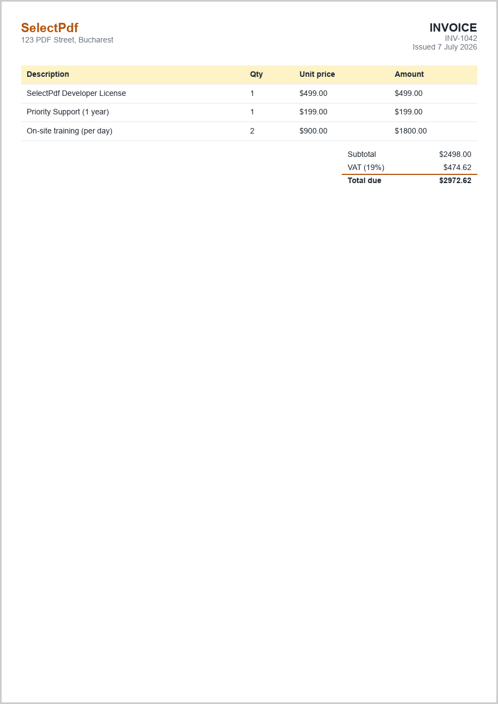</a>

> Full source: [Section20_ZugferdInvoice.cs](Section20_ZugferdInvoice.cs)

### 21. Add custom XMP metadata

Store your own fields - a document id, a department, a retention date - in the file's XMP metadata, without breaking PDF/A conformance.

```csharp
HtmlToPdf converter = new HtmlToPdf();
converter.Options.PdfStandard = PdfStandard.PdfA3B;

PdfDocument doc = converter.ConvertHtmlString(
    "<h1>Contract 2026-117</h1>" +
    "<p>Records-management fields are stored in the document's XMP metadata.</p>");
doc.DocumentInformation.Title = "Contract 2026-117";

// PDF/A only allows metadata from schemas it predefines, unless the schema is
// described inside the XMP packet. AddXmpExtensionSchema writes both the schema
// declaration and the values, so the file stays PDF/A-conformant.
doc.AddXmpExtensionSchema(
    "acme",                                   // namespace prefix
    "http://ns.acme.example/records/1.0/",     // namespace URI
    "Acme records management",                // human-readable schema name
    new Dictionary<string, string>
    {
        { "DocumentId", "CTR-2026-117" },
        { "Department", "Legal" },
        { "RetainUntil", "2036-12-31" },
    });

doc.Save(outputPdf);
doc.Close();
```

**Output:**

<a href="images/html-to-pdf-universal-section21.png">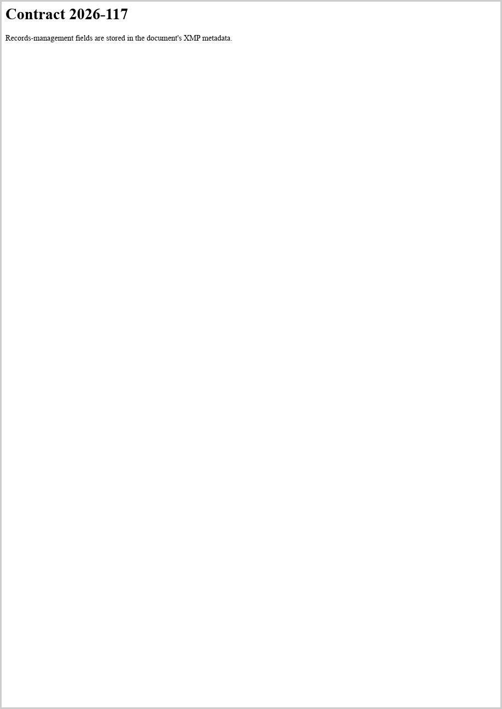</a>

> Full source: [Section21_XmpMetadata.cs](Section21_XmpMetadata.cs)

### 22. Generate a PDF in ASP.NET Core

Build the PDF in a controller action and stream it straight to the browser as a downloadable file.

```csharp
// In an ASP.NET Core app, generate the PDF inside a controller action and stream it back.
public sealed class InvoiceController : ControllerBase
{
    [HttpGet("/invoice/{id:int}")]
    public IActionResult Get(int id)
    {
        HtmlToPdf converter = new HtmlToPdf();

        PdfDocument doc = converter.ConvertHtmlString(
            $"<h1>Invoice #{id}</h1><p>Thank you for your order.</p>");

        // Save straight to a byte array - no temp file needed.
        byte[] pdf = doc.Save();
        doc.Close();

        // Return it as a downloadable file (omit the file name to show it inline).
        return File(pdf, "application/pdf", $"invoice-{id}.pdf");
    }
}
```

In a web app, prefer the asynchronous conversion from section 23 and pass `HttpContext.RequestAborted` as its cancellation token.

**Output:**

<a href="images/html-to-pdf-universal-section22.png"></a>

> Full source: [Section22_AspNetCore.cs](Section22_AspNetCore.cs)

## Part 6 - Only in SelectPdf.Universal

### 23. Convert asynchronously

Await the conversion instead of blocking a thread, and cancel it when it takes too long or the caller goes away.

```csharp
// Give up if the conversion takes longer than 30 seconds - or pass the
// request's token (HttpContext.RequestAborted) in a web app.
using CancellationTokenSource cts = new CancellationTokenSource(TimeSpan.FromSeconds(30));

HtmlToPdf converter = new HtmlToPdf();

// Await the conversion instead of blocking a thread while Chromium renders.
// PdfDocument is IDisposable, so a using declaration replaces Close().
using PdfDocument doc = await converter.ConvertHtmlStringAsync(
    "<h1>Converted asynchronously</h1>" +
    "<p>No thread was blocked while this page was rendered.</p>",
    cts.Token);

doc.Save(outputPdf);
```

`ConvertUrlAsync` works the same way. Up to 8 conversions run in parallel by default; change that with `Options.MaximumConcurrentConversions`.

**Output:**

<a href="images/html-to-pdf-universal-section23.png"></a>

> Full source: [Section23_AsyncConversion.cs](Section23_AsyncConversion.cs)

### 24. Generate a table of contents with page numbers

Build a table of contents from the document's headings, with dotted leaders, page numbers and clickable entries.

```csharp
HtmlToPdf converter = new HtmlToPdf();

// Draw the table of contents on pages of its own, inserted before the content.
// Each heading becomes a clickable entry with a dotted leader and its page number.
converter.Options.TableOfContents.Mode = PdfTableOfContentsMode.GeneratePages;
converter.Options.TableOfContents.HeadingSelectors = new string[] { "h1", "h2" };
converter.Options.TableOfContents.Title = "Employee handbook";

PdfDocument doc = converter.ConvertHtmlString(html);

doc.Save(outputPdf);
doc.Close();
```

There are three modes. `GeneratePages` draws the table on pages of its own, at the start, after a cover page or at the end (`PagePosition`). `InsertHtml` writes it into the page, styled by your CSS. `FillExisting` completes a table of contents the page already has, adding leaders and page numbers to its links.

**Output:**

<a href="images/html-to-pdf-universal-section24.png">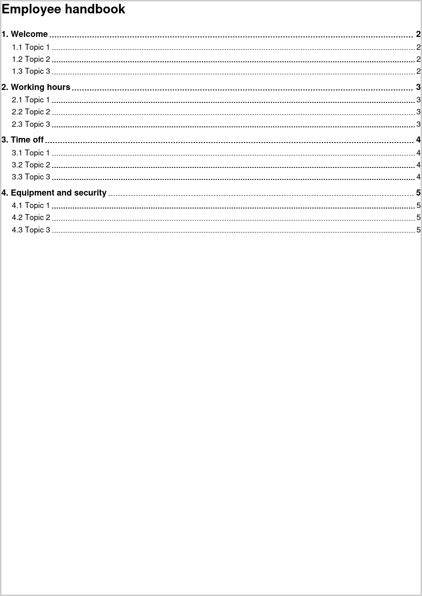</a>

> Full source: [Section24_TableOfContents.cs](Section24_TableOfContents.cs)

### 25. Turn an HTML form into fillable PDF fields

Convert an HTML form into a PDF form that people can fill in and save.

```csharp
            HtmlToPdf converter = new HtmlToPdf();

            // Every visible input, select and textarea becomes a PDF form field of the
            // matching kind, placed over the control and keeping its current value.
            converter.Options.CreateFormFields = true;

            PdfDocument doc = converter.ConvertHtmlString(@"
<form style='font-family:Arial;max-width:480px'>
  <h1 style='color:#b45309'>Course registration</h1>
  <p><label>Full name<br><input name='name' value='Jane Doe' style='width:100%'></label></p>
  <p><label>Email<br><input type='email' name='email' style='width:100%'></label></p>
  <p><label>Course<br>
    <select name='course'><option>HTML to PDF basics</option><option selected>Advanced layouts</option></select>
  </label></p>
  <p>Format:
    <label><input type='radio' name='format' value='online' checked> Online</label>
    <label><input type='radio' name='format' value='onsite'> On site</label></p>
  <p><label><input type='checkbox' name='newsletter' checked> Send me the newsletter</label></p>
  <p><label>Comments<br><textarea name='comments' rows='3' style='width:100%'></textarea></label></p>
</form>");

            doc.Save(outputPdf);
            doc.Close();
```

Text inputs, check boxes, radio buttons, drop-down lists and text areas become fields of the matching kind, with their names, current values and read-only, required and maximum-length settings. Password values, file inputs and buttons are not carried over.

**Output:**

<a href="images/html-to-pdf-universal-section25.png"></a>

> Full source: [Section25_FormFields.cs](Section25_FormFields.cs)

### 26. Create an accessible PDF/UA-2 document

Produce a tagged PDF that screen readers can navigate, declared as PDF/UA-2 and archivable as PDF/A-4.

```csharp
            HtmlToPdf converter = new HtmlToPdf();

            // PDF/UA-2 (accessibility) and PDF/A-4 (archiving) are both based on PDF 2.0,
            // so they combine. Selecting a UA standard turns on the tagged structure tree.
            converter.Options.AccessibilityStandard = PdfUAStandard.UA2;
            converter.Options.PdfStandard = PdfStandard.PdfA4;

            // Both standards require a document title and language.
            converter.Options.Title = "Annual accessibility statement";
            converter.Options.Language = "en-US";

            // Semantic HTML becomes the structure: headings, lists, tables and image alt text.
            PdfDocument doc = converter.ConvertHtmlString(@"
<html lang='en'><body style='font-family:Arial'>
  <h1>Annual accessibility statement</h1>
  <p>This document is tagged, so screen readers can follow its headings, lists and tables.</p>
  <h2>What we improved</h2>
  <ul><li>Keyboard navigation</li><li>Color contrast</li><li>Captions on all videos</li></ul>
  <h2>Audit results</h2>
  <table border='1' cellpadding='6' style='border-collapse:collapse'>
    <thead><tr><th scope='col'>Area</th><th scope='col'>Score</th></tr></thead>
    <tbody><tr><td>Web site</td><td>98</td></tr><tr><td>Documents</td><td>100</td></tr></tbody>
  </table>
</body></html>");

            doc.Save(outputPdf);
            doc.Close();
```

PDF/UA-2 and PDF/A-4 are both based on PDF 2.0, which is why they combine. For PDF 1.7 output, use `PdfUAStandard.UA1` with `PdfStandard.PdfA3A`. Write semantic HTML - real headings, lists, table headers and image `alt` text - because that is what the tags are built from.

**Output:**

<a href="images/html-to-pdf-universal-section26.png">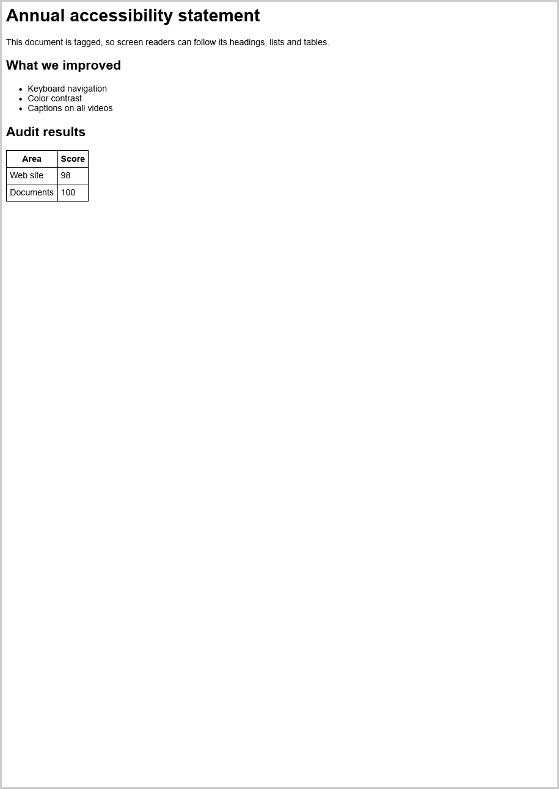</a>

> Full source: [Section26_AccessiblePdfUa2.cs](Section26_AccessiblePdfUa2.cs)

### 27. Redact text and patterns

Remove sensitive content - a known name, anything that looks like an e-mail address - from a document for good.

```csharp
            HtmlToPdf converter = new HtmlToPdf();
            using PdfDocument doc = converter.ConvertHtmlString(@"
<div style='font-family:Arial'>
  <h1>Support ticket #4471</h1>
  <p>Customer: Jane Doe (jane.doe@example.com)</p>
  <p>Jane Doe reported that invoices sent to billing@example.org were not delivered.</p>
  <p>Resolution: the mail filter was updated on 3 October.</p>
</div>");

            // Redaction deletes the content from the file - it is not just covered -
            // and paints each area over. The text around it keeps its position.
            using PdfRedactionManager redactor = new PdfRedactionManager();
            redactor.Load(doc);
            redactor.OverlayText = "[REDACTED]";

            // A known value, whole words only, any letter case...
            redactor.AddRedaction("Jane Doe", false, true);
            // ...and anything that follows a pattern, here e-mail addresses.
            redactor.AddRedaction(new Regex(@"[\w.+-]+@[\w-]+\.[\w.]+"));

            redactor.Save(outputPdf);
```

The content is deleted from the file, not just covered with a box, and a text is also removed from the document properties, bookmarks, annotations and form fields. To redact an area instead, call `AddRedaction(pageIndex, rectangle)`. `Redact()` returns one `PdfRedactionResult` per removed area.

**Output:**

<a href="images/html-to-pdf-universal-section27.png"></a>

> Full source: [Section27_Redaction.cs](Section27_Redaction.cs)

### 28. Sign a PDF and validate the signature

Sign the document with a certificate, then check that the signature is intact, trusted and covers the whole file.

```csharp
HtmlToPdf converter = new HtmlToPdf();
using PdfDocument doc = converter.ConvertHtmlString(
    "<h1 style='font-family:Arial'>Service agreement</h1>" +
    "<p style='font-family:Arial'>Signed electronically by SelectPdf.</p>");

// Load the signing certificate from a password-protected .pfx file.
using PdfDigitalCertificatesCollection certificates =
    PdfDigitalCertificatesStore.GetCertificates(pfxFile, pfxPassword);

// Add a visible signature to the first page. The document is signed when saved.
PdfDigitalSignatureElement signature = new PdfDigitalSignatureElement(
    350, 120, 180, 60, certificates[0]);
signature.Reason = "Agreement accepted";
signature.Location = "Bucharest";
signature.DigestAlgorithm = PdfSignatureDigest.SHA384;
doc.Pages[0].Add(signature);

doc.Save(outputPdf);

// Check the signature. A self-signed certificate is only trusted when it is
// passed in as a trusted root, the way you would pass your own CA.
using PdfSecurityManager security = new PdfSecurityManager();
security.Load(outputPdf);
foreach (PdfSignatureValidationResult result in security.ValidateSignatures(certificates))
{
    Console.Write($"signer={result.SignerName}, valid={result.IsValid}, trusted={result.IsTrusted}, " +
                  $"modified={result.IsDocumentModified} ... ");
}
```

The example creates a throwaway self-signed certificate so it runs anywhere. In production, load your own `.pfx`, read a certificate from the Windows, macOS or Linux certificate store, or sign with a key that never leaves a USB token, smart card or HSM by passing a `PdfPkcs11Signer` to `PdfDigitalSignatureElement`. Set `EnableLtv = true` to embed revocation data, so the signature can still be validated after the certificate expires.

**Output:**

<a href="images/html-to-pdf-universal-section28.png"></a>

> Full source: [Section28_DigitalSignature.cs](Section28_DigitalSignature.cs)

### 29. Convert a Word document to PDF

Convert DOCX, DOC, RTF, WordML, text, HTML or Markdown to PDF, in-process and without Microsoft Word.

```csharp
// WordToPdf reads DOCX, DOC, RTF, WordML, TXT, HTML and Markdown.
// Its Options, Header and Footer mirror the HTML converter's.
WordToPdf converter = new WordToPdf();
converter.Options.MarginTop = 40;
converter.Options.MarginBottom = 40;

// For a file, the format comes from the extension: converter.ConvertFile("report.docx").
// Markdown, text and HTML have no signature, so in memory the format is named.
string markdown =
    "# Release notes\n\n" +
    "Version **26.5** adds:\n\n" +
    "- tables of contents with page numbers\n" +
    "- fillable form fields from HTML forms\n" +
    "- signing with hardware tokens\n\n" +
    "| Platform | Status |\n|---|---|\n| Windows | Supported |\n| Linux | Supported |\n";

PdfDocument doc = converter.ConvertBytes(Encoding.UTF8.GetBytes(markdown), WordFormat.Markdown);

doc.Save(outputPdf);
doc.Close();
```

`WordToPdf` uses the same `Options`, `Header` and `Footer` as the HTML converter, so the page setup you wrote for HTML applies unchanged. Page sizes follow the document, and the output can be PDF/A or PDF/UA.

**Output:**

<a href="images/html-to-pdf-universal-section29.png">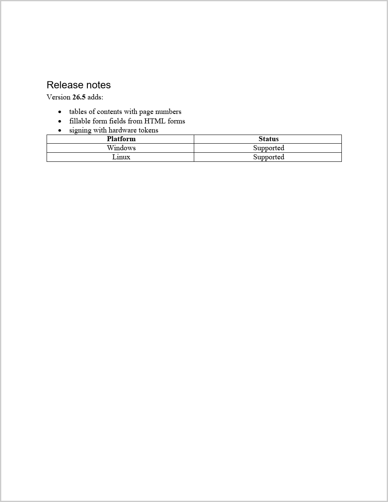</a>

> Full source: [Section29_WordToPdf.cs](Section29_WordToPdf.cs)

## Part 7 - Run it in production

### 30. Run on Linux and in Docker

On Linux, the `SelectPdf.Universal.Linux` package bundles everything Chromium needs: there are no `apt-get` packages to install, no X server, and no special container flags. Rendering is headless, Liberation fonts are included, and the container can run as a non-root user. You need glibc 2.30 or later (Debian 11+, Ubuntu 20.04+, RHEL 9+, Amazon Linux 2023).

This tutorial ships with a [Dockerfile](Dockerfile) that builds and runs all 29 sections on Linux:

```bash
docker build -t selectpdf-universal-tutorial .
```

```bash
docker run --rm -e SELECTPDF_LICENSE_KEY -v "$PWD/output:/tutorial/output" selectpdf-universal-tutorial
```

It uses the official `mcr.microsoft.com/dotnet/sdk:8.0` and `aspnet:8.0` images unchanged, and runs as their non-root `app` user. The only extra step is giving that user the folder it writes to.

### 31. Use the remote engine for Alpine and Kubernetes

The native engines need glibc, so they don't run on Alpine Linux or other musl-based images. For those, and to scale rendering separately from your app, run the engine in its own container and point the library at it:

```csharp
// Once at startup, before the first conversion.
GlobalProperties.RenderingEngine = RenderingEngine.ChromiumRemote;
GlobalProperties.EngineEndpoint = "http://selectpdf-engine:8080";
```

Or set the `SELECTPDF_RENDERING_ENGINE=ChromiumRemote` and `SELECTPDF_ENGINE_ENDPOINT` environment variables, with no code change. The engine is the `ghcr.io/selectpdf/engine` image (linux/amd64 and linux/arm64), and the default endpoint is a service named `selectpdf-engine` on port 8080. HTML to PDF, HTML to image, PDF to text and PDF to image all run there, so your app needs no native package at all.

- **Secure it** - start the engine with `SELECTPDF_ENGINE_TOKEN` and set the same token in `GlobalProperties.EngineAccessToken` (or `SELECTPDF_ENGINE_TOKEN`). Use an https endpoint when the engine is on another machine.
- **Local files** - the engine can't see your app's files. Convert HTML strings or http(s) URLs. Section 3, which converts a file from disk, is the one section of this tutorial that fails with the remote engine.
- **Where it runs** - Docker Compose, Kubernetes (a Helm chart is available), Azure Container Apps, Amazon ECS and Google Cloud Run.

### 32. Running in production

- **Platforms** - Windows x64 and x86, Linux x64 and ARM64 with glibc 2.30+, macOS 13+ on Apple Silicon, and any of these in containers. Not supported: Windows on ARM64 and Intel Macs. Use the [online API](https://selectpdf.com/html-to-pdf-api/) there.
- **Engine hosting** - Chromium runs in-process by default. Set `GlobalProperties.ChromiumEngineHostMode` at startup to run it out of process instead, or `Options.ForceOutOfProcess` for a single conversion.
- **Concurrency** - one `HtmlToPdf` per conversion. The library runs up to 8 conversions at once (`Options.MaximumConcurrentConversions`) and queues the rest.
- **HTTP cache** - the engine keeps an HTTP cache by default. In a multi-user service, set `Options.HttpCache = HttpCacheMode.Clear` so one user's cached responses never reach another.
- **Timeouts** - the navigation timeout is 60 seconds. Raise `Options.NavigationTimeout` for slow pages and use `Options.ConversionDelay` to wait for late assets.
- **Smaller files** - `Options.ImagesMaxResolution = 150` resamples oversized photos, which can shrink photo-heavy PDFs a lot (use 300 for print).
- **Licensing** - set `GlobalProperties.LicenseKey` once at startup, before any conversion. One perpetual developer license covers both SelectPdf.Universal and the classic Windows library.
- **Untrusted HTML** - disable scripts (`Options.JavaScriptEnabled = false`) and local file access (`Options.DenyLocalFileAccess = true`, or `GlobalProperties.ForceDenyLocalFileAccess` for the whole app).
- **Azure** - App Service and Functions work on Windows and Linux, Basic plan or above. On Windows, deploy with Zip Deploy or Web Deploy, because "Run From Package" breaks the engine.

### 33. Troubleshooting

- **Images and CSS missing from an HTML string** - pass a base URL: `ConvertHtmlString(html, baseUrl)`. An http(s) base URL is also the page's origin, so its web fonts, fetch calls and cookies behave as if the URL itself were converted.
- **Dynamic content missing** - give the page time with `Options.ConversionDelay`, or wait for a signal with `Options.WindowStatus`.
- **"The native engines do not run on Alpine Linux"** - you are on a musl-based image. Use the remote engine (section 31) or a Debian- or Ubuntu-based image.
- **"A local file cannot be converted by the SelectPdf engine container"** - with the remote engine, convert the HTML as a string or serve it over http.
- **Squares instead of Arabic, CJK or Hindi text** - add the `SelectPdf.Universal.Fonts` package, or install fonts for those scripts on the host.
- **`PdfDocumentException` about a missing font** - `PdfFont.CreateFromSystemFont` never substitutes a family that isn't installed. Use one of the bundled Liberation families, or check `PdfSystemFonts.IsFamilyInstalled` first.
- **Content wider than the page is cut off** - set `Options.FitWideContent = true` (section 14).
- **A WebGL map or 3D chart is blank** - WebGL is off by default because that makes conversions faster. Set `Options.WebGlEnabled = true` for pages that need it.
- **`LicenseException`** - the license key is invalid or expired.

## FAQ

### 34. Frequently asked questions

- **Should I use SelectPdf.Universal or the classic library?** - Universal for new projects on modern .NET, for Linux, macOS, Docker or ARM64, and for Word to PDF, redaction, PDF/A-4 or PDF/UA-2. Stay with the [classic library](../html-to-pdf/) for .NET Framework 2.0 to 4.5, for its WebKit or Blink engines, or for direct printing.
- **Which .NET versions does it support?** - .NET 8 and .NET 10, plus .NET Standard 2.0, so it also runs on .NET Framework 4.6.1 and later.
- **Do I need a new license?** - No. One perpetual per-developer license covers both SelectPdf.Universal and the classic library. See [pricing](https://selectpdf.com/pricing/).
- **Is there a free version?** - Yes. `SelectPdf.HtmlToPdf.Universal` (or `SelectPdf.HtmlToPdf.Windows`, `.Linux`, `.Linux.Arm64`, `.MacOS`) is the free Community Edition: HTML to PDF only, up to 5 pages per document, free for commercial use. `ConversionResult.PdfPageCountBeforeLimit` tells you when a document was cut short.
- **How much code changes when porting from the classic library?** - Most of it carries over apart from the namespace. Compare sections 1 to 22 here with the [classic tutorial](../html-to-pdf/), and see the [migration guide](https://selectpdf.com/pdf-library-classic/html/Migrating-To-SelectPdf-Universal.htm).
- **Does it need Chromium, Word or anything else installed?** - No. The platform package carries the engine, and Word to PDF runs in-process.
- **How do I remove the trial watermark?** - Set `GlobalProperties.LicenseKey` once at application startup, before any conversion.
- **Is the converter thread-safe?** - Use one `HtmlToPdf` instance per conversion. The library already limits how many run at once (see Running in production).

## Conclusion

That is HTML to PDF with SelectPdf.Universal, from a three-line conversion to e-invoices, accessible PDF/UA-2, redaction and signatures. The same code runs on a Windows laptop, a Linux container and a Mac, and on Alpine or Kubernetes through the remote engine. Start with a [free trial](https://selectpdf.com/downloads/), read the [cross-platform library overview](https://selectpdf.com/pdf-library-cross-platform/), or compare with the [classic Windows tutorial](../html-to-pdf/).
